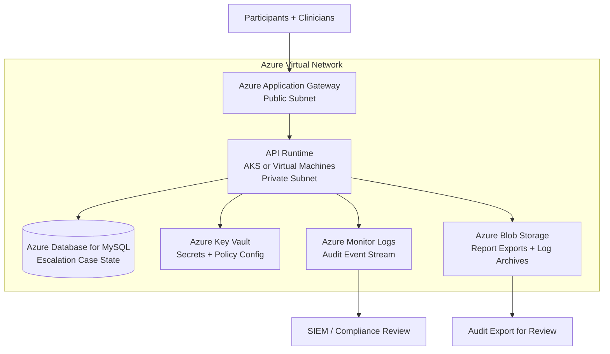

# Deployment Architecture: Microsoft Azure Reference

## Overview

This document describes a reference deployment architecture for the AcuityBridge Safety & Escalation Orchestrator on Microsoft Azure. It maps each orchestrator component to specific Azure services, demonstrating how the system would operate in a production cloud environment.

**DISCLAIMER:** This document describes a reference deployment architecture. Actual deployment requires partner-specific configuration, executed Business Associate Agreements (BAAs), security review, and compliance validation. This is not an operational deployment guide.

---

## Component Mapping

### Service-to-Component Mapping

| Orchestrator Component | Azure Service | Purpose |
|----------------------|-------------|---------|
| API runtime (orchestrator endpoints) | **Azure Kubernetes Service (AKS)** or **Azure Virtual Machines** | Hosts the escalation orchestrator, signal evaluator, and API layer. AKS provides auto-scaling and health monitoring. |
| Partner policy storage | **Azure Key Vault** | Stores partner-specific policy configurations and secrets (API keys, webhook credentials). Key Vault provides HSM-backed encryption and access controls. |
| Escalation case persistence | **Azure Database for MySQL Flexible Server** | Stores escalation case state, participant enrollment records, and check-in history. The managed service provides automatic patching and encryption at rest. |
| Audit event stream | **Azure Monitor Logs** + **Azure Event Hubs** | Receives append-only audit events in real time. Event Hubs enables downstream consumers (SIEM, compliance dashboards) without modifying the primary log. |
| Transparency report exports | **Azure Blob Storage** | Stores generated Decision Transparency Reports and audit export bundles. Blob Storage supports versioning and retention policies for compliance. |
| Audit log archive | **Azure Blob Storage** (with immutability policies) | Long-term audit log storage with configurable retention. Immutability policies can enforce WORM-like behavior for compliance. |
| Load balancing and TLS termination | **Azure Application Gateway** | Terminates TLS, distributes traffic across API instances, provides health checks. |
| Network isolation | **Azure Virtual Network (VNet)** | Private subnets for API and database; public subnet for the gateway only. Network security groups restrict all traffic to required ports. |

---

## Security Architecture

| Layer | Azure Implementation |
|-------|-------------------|
| Encryption in transit | TLS 1.2+ at Application Gateway; mutual TLS between services where applicable |
| Encryption at rest | Azure Database for MySQL and Blob Storage encrypt by default; Key Vault provides HSM-backed key management |
| Identity and access | Microsoft Entra ID and Azure RBAC with least privilege; managed identities for inter-service auth |
| Network segmentation | VNet with public/private subnet separation; network security groups |
| Audit and monitoring | Azure Activity Log for infrastructure events; application-level audit via `audit.py` |
| Compliance readiness | Azure services support healthcare compliance requirements, including a Microsoft BAA where applicable |

---

## Why Azure

This reference architecture uses Microsoft Azure for the project's deployment requirements:

1. **Healthcare workload support.** Azure supports healthcare workloads with a Business Associate Agreement and compliance certifications relevant to care-setting deployments where applicable.

2. **FedRAMP availability.** For government and VA-affiliated partners, Azure Government regions provide the FedRAMP posture required for deployment in federal healthcare settings.

3. **Managed runtime and custody of secrets.** AKS, Key Vault, and Blob Storage with immutability policies cover the orchestrator runtime, partner secrets, and retained audit archives.

4. **Cost efficiency for pilot deployments.** An Azure free account and low-cost managed services support the project's phased deployment strategy, enabling sandbox and limited pilot phases without prohibitive infrastructure costs.

---

## Deployment Phases

| Phase | Infrastructure | Scale |
|-------|---------------|-------|
| Sandbox (v0.1) | Single virtual machine; local SQLite or Azure Database for MySQL on the free account | 1 partner, synthetic data only |
| Limited Pilot (v0.2) | AKS cluster (2-3 nodes); Azure Database for MySQL; Key Vault; Azure Monitor | 1-3 partners, 10-20 participants per partner |
| Production (v1.0) | Zone-redundant AKS; Azure Database for MySQL with a replica; Blob Storage with immutability; full Monitor + Event Hubs pipeline | Multiple partners, national-scale |

---

*This document is part of the AcuityBridge technical documentation suite. For system architecture details, see `docs/01_architecture.md`. For security and privacy specifics, see `docs/03_security_privacy.md`.*
